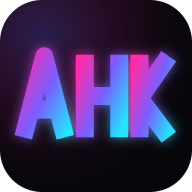

<p align="center">
  
</p>

<h1 align="center">AHK · Artist House Karaoke</h1>

<p align="center">
  <strong>Turn the TV into a karaoke machine. Everyone's phone is a remote.</strong><br />
  Open a room on the big screen, friends scan the QR, pick songs, and sing together.<br />
  No app install, no account.
</p>

<p align="center">
  
  
  
  
</p>

<p align="center">
  <a href="#how-a-night-works">How it works</a> ·
  <a href="#hosting">Hosting</a> ·
  <a href="#for-developers">Developers</a> ·
  <a href="docs/ahk/PLAN.md">Roadmap</a> ·
  <a href="docs/ahk/CREDITS.md">Credits</a> ·
  <a href="#copyright-and-legal-notice">Legal</a>
</p>

---

## What is AHK?

AHK is a browser-based group karaoke app for houses, studios, and friend groups. One screen plays the video;
everyone else controls it from their phone. It is a fork of [vkara](https://github.com/lehuygiang28/vkara)
with its own look, English and Spanish UI, and (coming next) curated **Song Packs**.

- **Nobody types on a TV remote.** Search and queue from a phone keyboard.
- **Everyone adds songs.** The queue is shared and live.
- **One player screen.** The TV stays on the video; phones handle control.
- **Browser only.** Works on any TV browser, laptop, or phone. Nothing to install.
- **Self-host if you want.** One Docker image runs the full stack.

## How a night works

1. **TV or laptop:** open AHK and tap *Create new room*. A **4-digit code** and **QR** appear.
2. **Phones:** open the same site and scan the QR or type the code.
3. **Sing:** search YouTube karaoke, build the queue, skip, pause. Everyone stays in sync.

| Situation | What to do |
| --- | --- |
| Old or slow TV browser | Plug in a laptop over HDMI and open `/tv` |
| Want karaoke versions only | Keep the **Karaoke** filter on when searching |
| UI in Spanish | Open `/es` or switch in Appearance |
| Family night | Set a room password; lock the room once everyone is in |

## FAQ

**Do I need an account?** No. Join with a room code or QR. Hosts can set an optional room password.

**Where do the songs come from?** YouTube, played inside YouTube's embedded player. Some videos cannot be embedded; AHK skips those.

**Is AHK affiliated with YouTube?** No. AHK uses YouTube search and embedded playback but is not affiliated with or endorsed by YouTube.

**Why two layouts (TV vs phone)?** The player screen is for watching; phones are for searching and controlling.

## Copyright and legal notice

AHK is open-source software under the MIT License, intended for personal, non-commercial karaoke via YouTube's
embedded player. It does not store, download, or distribute music or video files. The project has no music
licensing agreements and does not commercialize content.

- Playback runs inside YouTube's iframe; AHK does not re-stream content.
- Public or commercial use is the responsibility of the deployer under applicable law and
  [YouTube's Terms of Service](https://www.youtube.com/t/terms).
- Self-hosting deployers are responsible for how they configure and operate their instance.

Full disclaimer: [docs/DISCLAIMER.md](docs/DISCLAIMER.md).
Copyright complaints, takedown requests, and support: open an issue at
[github.com/jdmiami/AHK/issues](https://github.com/jdmiami/AHK/issues).

---

## Hosting

AHK is two services: the **web app** (Next.js) and the **API** (Bun + Elysia, needs Redis).

| Part | Recommended host | Notes |
| --- | --- | --- |
| Web | [Vercel](https://vercel.com) | Root directory `apps/web`; `apps/web/vercel.json` carries the build command. Preview deploys on every PR. |
| API + Redis | RunPod (what AHK uses), a VPS, or any Docker host | `containers/api-redis/Dockerfile` bundles API and Redis in one container. |
| Everything in one box | Any Docker host | `docker compose --profile aio up --build` serves web and API on port 3000. |

Point the web app at the API with `NEXT_PUBLIC_API_URL` and `NEXT_PUBLIC_WS_URL`. Full guide, env tables, and
compose profiles: **[containers/README.md](containers/README.md)**.

Pre-built images are published under the Docker Hub owner set in the repo variable `DOCKERHUB_OWNER`
(see `.github/workflows/build-push-docker.yml`); publishing is off until that variable and the Docker Hub
secrets exist.

---

## For developers

<details>
<summary><strong>Local development</strong></summary>

**Requirements:** [Bun](https://bun.sh) ≥ 1.4.4, Redis, Node.js 22.23.4 for production web builds (24.22.1 on Node 24, 26.12.1 on Node 26).

```bash
git clone https://github.com/jdmiami/AHK.git
cd AHK
bun install
```

Copy env files:

- `apps/api/.env.example` → `apps/api/.env`
- `apps/web/.env.example` → `apps/web/.env.local`

Start Redis (example):

```bash
docker run -d --name ahk-redis -p 6379:6379 redis:7-alpine \
  redis-server --requirepass giang
```

Run:

```bash
bun run dev          # web :3000 + API :8000
bun run dev:web
bun run dev:api
```

</details>

<details>
<summary><strong>Tech stack</strong></summary>

| Layer | Stack |
| --- | --- |
| Frontend | Next.js 15, React 19, Tailwind, zustand |
| Backend | Bun, Elysia, WebSockets |
| State | Redis (rooms are ephemeral; no database, no accounts) |
| Repo | Bun workspaces, Turborepo, Vitest, OpenSpec |

Optional voice search: [Whisper STT](containers/whisper-stt/README.md).

</details>

<details>
<summary><strong>Repository layout</strong></summary>

```text
AHK/
├── apps/
│   ├── web/                 frontend (Next.js)
│   └── api/                 backend (Bun + Elysia)
├── packages/
│   ├── env/                 t3-env + feature flags
│   ├── validators/          zod WS + HTTP schemas
│   ├── youtube/             YouTube types + utils
│   ├── room/                room / WS server types
│   ├── personalization/     browse ranking profile
│   ├── curated-playlists/   starter playlists (superseded by Song Packs)
│   ├── redis/               Redis options factory
│   └── cache-redis/         Redis cache helpers
├── containers/
│   ├── aio/                 all-in-one Docker image
│   ├── api-redis/           API + Redis bundle
│   └── whisper-stt/         optional voice search
├── docs/ahk/                roadmap, credits
├── openspec/                spec-driven change proposals
└── docker-compose.yml
```

Realtime message shapes live in `packages/validators` (zod); room/YouTube domain types in `packages/room` and
`packages/youtube`. Update validators first when changing WS or HTTP contracts. Internal package names keep the
upstream `@vkara/*` scope on purpose so upstream fixes stay easy to port.

**Brand assets:** SVG sources in `apps/web/brand/`; `bun run generate:pwa-icons` (in `apps/web`) regenerates
icons, favicon, and the OG image.

**Scripts:** `bun run dev` · `bun run test` · `bun run typecheck` · `bun run lint` · `bun run build` · `bun run format`

**Docs:** [Roadmap](docs/ahk/PLAN.md) · [Monorepo architecture](docs/monorepo-architecture.md) · [URL commands / agents](docs/agents/url-commands.md)

</details>

## Contributing

Issues and pull requests welcome. Change `packages/validators` (and related domain packages) when altering API
or realtime message shapes. Changes are proposed as OpenSpec folders under `openspec/changes/`.

## Credits

AHK is based on [vkara](https://github.com/lehuygiang28/vkara) by
[@lehuygiang28](https://github.com/lehuygiang28) (MIT). Library thanks and what changed in the fork:
[docs/ahk/CREDITS.md](docs/ahk/CREDITS.md).

## License

MIT - see [LICENSE](LICENSE).

<p align="center">
  <a href="https://github.com/jdmiami/AHK">github.com/jdmiami/AHK</a>
</p>
